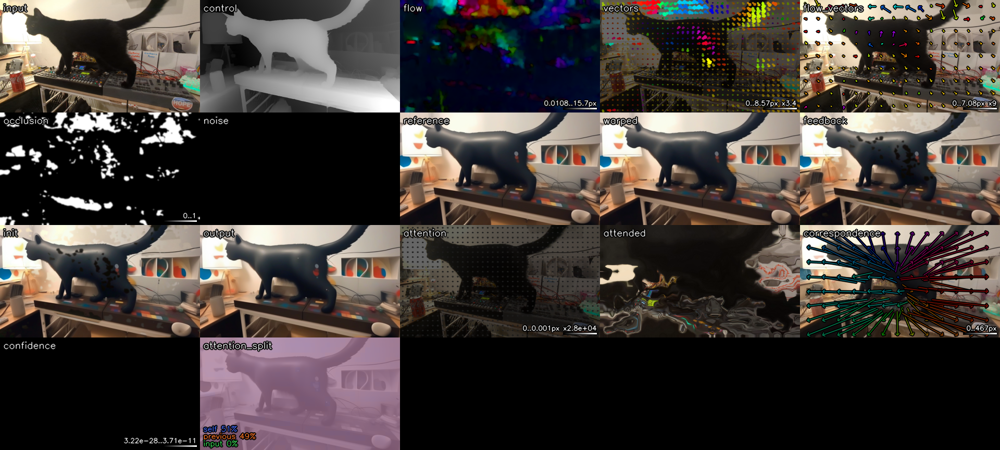

# vfbd3

Restyle video with diffusion models. Successor to
[controlnetvideo](https://github.com/un1tz3r0/controlnetvideo), built to run on a Colab T4.



Two engines, same inputs and outputs:

| | `vace` | `frame` |
|---|---|---|
| Model | Wan 2.1 VACE (video diffusion) | SDXL, Flux or SD3 + ControlNet (image diffusion) |
| Temporal consistency | from the model, across overlapping windows | motion-compensated feedback of the previous output |
| Look | stable, coherent motion | trails, drift, flow smearing: the feedback-loop look |
| Generates at | ~480p, 16 fps, then upscaled | 720p directly, input frame rate |

## Colab

Open `notebooks/vfbd3_colab.ipynb` in Colab with a T4 (or better) runtime. Keep the output on
Drive: frames are saved to `<output>.work/` as they finish, and re-running a cell after a
disconnect continues from the last finished frame.

## Command line

```sh
pip install "vfbd3[upscale,aux,flux,youtube] @ git+https://github.com/un1tz3r0/vfbd3"

vfbd3 vace  in.mp4 out.mp4 --prompt "a colorful murakami mural" --upscale 720 --fast causvid
vfbd3 frame in.mp4 out.mp4 --prompt "murakami mural" --denoise 0.5 --fast lcm --tiny-vae encoder
vfbd3 frame in.mp4 out.mp4 --prompt "murakami mural" --feedthrough 1 --reference 1 --reference-adain 0.5 \
    --preview live.png --preview-panels input,flow,occlusion,output
vfbd3 frame in.mp4 out.mp4 --prompt "murakami mural" --backend flux --control hed
vfbd3 upscale out.mp4 out_1080.mp4 --short-side 1080
vfbd3 filters          # list filters for the --*-filter options
```

`vfbd3 vace --help` and `vfbd3 frame --help` list every option. ffmpeg must be on the path.
The extras are optional: `aux` adds the controlnet_aux detectors, `flux` the GGUF loader,
`youtube` yt-dlp for `vfbd3.video.download(url)`.

## How each engine works

**vace** splits the clip into windows of `--chunk-frames` (81). Each frame handed to the model
is either *known* (kept as is) or *generated* from a control signal extracted from the input
(depth by default). The last `--overlap` output frames of one window are the known head of
the next, and `--anchor first` gives every window the first output frame as a reference.
`--warp-frames N` (experimental) additionally pre-fills the N frames after the overlap with the
last known frame warped along the input's optical flow, leaving only disoccluded areas to generate.

**frame** runs, per frame: optical flow between the previous and current input → warp the
previous output along it → blend with the current input (`--feedthrough`) → img2img at
`--denoise` under the control signal → feed the result back. `--ip-adapter` also conditions
on the warped previous output as an image prompt.

Newly revealed (disoccluded) areas, found by a forward/backward flow check, are generated
anew at `--occlusion-denoise` (1.0) while the rest of the frame keeps `--denoise`: every pixel
is held at its noised original until the schedule reaches that pixel's own denoise level. A
frame with such areas therefore runs the full `--steps`; `--no-occlusion` turns this off.

The starting noise is one field that is carried along the same flow (`--noise warp`), so a
surface is seeded with the same noise in every frame. `--noise fixed` keeps it still on screen
and `--noise random` redraws it each frame, as controlnetvideo did. Filter chains (`--input-filter`, `--feedback-filter`,
`--control-filter`, `--output-filter`) use the controlnetvideo filter syntax.

### frame backends

| `--backend` | model | ControlNet | on a T4 |
|---|---|---|---|
| `sdxl` (default) | SDXL base, or any SDXL checkpoint | xinsir ControlNet-Union: depth, normal, softedge, lines, pose | fp16, fits |
| `flux` | FLUX.1-dev, transformer as 4-bit GGUF | Shakker-Labs Union-Pro-2.0: depth, softedge, lines, pose, gray | about 11 GB; T5 encodes the prompt once and is freed first |
| `sd3` | SD3 Medium | InstantX depth / canny / pose, alimama softedge | fp16, fits |

Flux and SD3 are gated on Hugging Face (accept the licence, log in or set `HF_TOKEN`).
`--transformer` takes any single-file or GGUF checkpoint, e.g. a Q8 GGUF on a bigger card.

### Controls

`depth` (Depth Anything V2 small), `depth_large`, `zoe`, `midas`, `normal` (from depth),
`canny` and `gray` need nothing extra. `hed`, `pidi`, `lineart`, `lineart_anime`, `mlsd`,
`pose` (OpenPose with hands and face) and `normalbae` use controlnet_aux. The backend picks
the ControlNet or union mode from the control's family.

### Reference attention (sdxl)

controlnetvideo's reference-only mode, generalised. Every self-attention layer attends to
its own tokens plus those of the previous output (`--reference`, motion-compensated unless
`--no-reference-warp`) and of the current input (`--reference-input`). Each strength is added
to the attention scores as log(strength), so 0 is off, 1 is plain shared attention and more
favours that image. `--reference-adain` matches feature statistics to the previous output,
which holds colour. The old `refxl` recipe: `--feedthrough 1 --denoise 0.5 --reference 1
--reference-adain 0.5`. It costs one extra UNet pass per step.

`--flow-remap` (experimental) uses the same attention as a correspondence: for each output
location, where in the input frame it was drawn from. The next frame then moves each part of
the output by the input motion *of its source*, rather than the motion at its own position,
which helps when heavy denoising has moved or reshaped things. It is read at the coarsest
attention level (1/32 of the frame) and falls back to plain flow where attention is diffuse.

### Live preview

`--preview FILE` rewrites FILE after every frame, writing a temporary file and renaming it
over the old one so a viewer never sees a partial image. `--preview-panels` makes it a
labelled mosaic of any of these (or `all`). In Python, `frame.run(..., on_preview=fn)`
receives each image.

Panels are normalised per frame so faint signals stay visible: flow, noise and masks such as
`confidence` are stretched to their own min..max, and arrow panels magnify small offsets until
the longest reaches about one arrow spacing (`vectors` also shrinks large ones). A ramp in the
lower-right corner gives the range shown and the arrow gain, e.g. `0..2.47px x11`.

| panel | shows |
|---|---|
| `input`, `control`, `feedback`, `init`, `output` | the images of the loop |
| `flow` | the motion the previous output was moved by, as colour (hue: direction, brightness: speed) |
| `vectors` | the same motion averaged over 32 px cells, with arrows over the previous input, scaled to fit a cell |
| `flow_vectors` | the same motion as a grid of arrows over the previous and current input, blended 50/50 |
| `occlusion` | newly revealed areas, generated anew |
| `noise` | the starting noise (first three latent channels) |
| `reference`, `warped` | the previous output before and after motion compensation |
| `attention` | sdxl: correspondence arrows over the input, shortened and greyed by confidence |
| `attended` | sdxl: the input resampled through the correspondence |
| `correspondence` | sdxl: where each part of the output was drawn from in the input, as arrows over the two blended |
| `confidence` | sdxl: how concentrated that attention was (white: within about one token) |
| `attention_split` | sdxl: how attention divides between the frame itself (blue), the previous output (orange) and the input (green), with the mean shares |

An arrow starts where a point was in the first image and ends where it is in the second, so
where the motion is right its head lands on the matching feature. Arrow colour is direction,
on the same wheel as `flow`; dim arrows in `correspondence` are low confidence. The
sdxl panels come from the coarsest attention level (1/32 of the frame) on the last step.
`attention_split` needs `--reference` or `--reference-input`; `attention`, `attended`,
`correspondence` and `confidence` add a reference pass on the input even without them
(at strength 0, so the output is unchanged, but it costs one extra UNet pass per step,
as `--flow-remap` does).

### Colour creep

A feedback loop compounds whatever happens to colour each frame. Measured over 15 encode and
decode round trips with no diffusion at all: TAESDXL's decoder raises mean chroma from 12.5 to
23.6 and clips 15% of pixels; the full SDXL VAE slowly desaturates instead. Hence
`--tiny-vae encoder` (tiny encoder, full decoder). To hold the look, use `--color-fix`
(match the first output) or a feedback filter: `colorlock` holds brightness, contrast and
saturation at the first frame's, `autolevel` restretches lightness, `equalize` is CLAHE.

## Fewer steps

`--fast` picks a distilled setup and sets `--steps` and `--guidance` to match (both can still
be overridden, and `--lora` adds more LoRAs on top).

| engine | `--fast` | what it loads | steps |
|---|---|---|---|
| vace | `causvid` | CausVid LoRA for Wan 2.1 1.3B | 8 |
| vace | `selfforcing` | Self-Forcing (DMD) LoRA for Wan 2.1 1.3B | 4 |
| frame | `lcm` | LCM-LoRA SDXL, LCM scheduler | 8 |
| frame | `lightning` | SDXL-Lightning 8-step LoRA, trailing Euler | 8 |
| frame | `dmd2` | DMD2 4-step LoRA, LCM scheduler | 4 |
| frame | `turbo` | SDXL-Turbo checkpoint; use `--short-side 512 --upscale 720` | 4 |

All of them run without classifier-free guidance, which halves the work per step again. In
`frame`, `--steps` is the full schedule and a frame runs `steps * denoise` of it, so `turbo`
or `dmd2` at `--denoise 0.25` is a single step. Flux has `--fast schnell` (4 steps).

## Development

```sh
uv venv && uv pip install -e ".[upscale,dev]"
pytest                 # runs on CPU; -m "not slow" skips the tests that download models
```

The tests exercise both engine loops, chunking, resume, motion compensation, the backends'
masked regeneration, reference attention, previews and the upscaler on CPU, using tiny
randomly-initialised SDXL, Flux, SD3 and VACE pipelines. They do not run the full-size models.

## Not here yet

Audio-reactive parameter animation (`frame.run` takes an `on_frame` hook for it), prompt
sequencing, reference attention for Flux and SD3, frame interpolation back to the input frame rate for
`vace`, and a diffusion-based upscaler.
